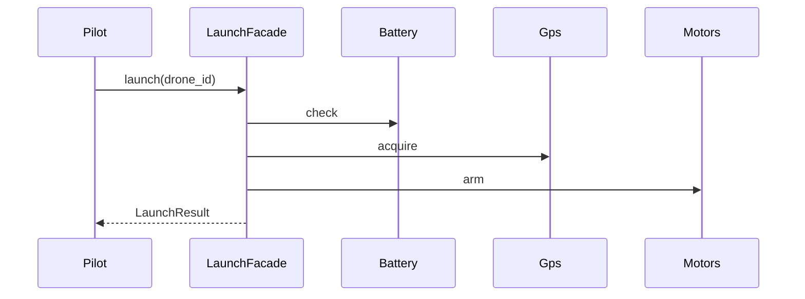

# Guide 07 — Facade

**Lab:** [Requirements](../../phases/phase-07/requirements.md) · [Guided check](../../phases/phase-07/guided-check.md) · [Questions](../../phases/phase-07/questions.md)

## Chapter 7: "One button for FieldWing"

A pilot wants survey drone `wing-4` in the air on **FieldWing**. Launch is five steps: battery check, GPS lock, arm motors, start camera, tell the ground station. The pad button does that dance itself. The mission scheduler would have to copy it.

You need a **Facade**: one operation—`LaunchFacade.launch(drone_id)`—that orchestrates the subsystem.

*Head First Design Patterns* pairs Facade with Adapter in Chapter 7. Refactoring Guru: provide a simplified interface to a set of subsystems ([Facade](https://refactoring.guru/design-patterns/facade)).

---

## Learning Objectives

By the end of this guide you will be able to:

- State Facade’s intent
- Design a small façade that orchestrates without owning all domain logic
- Contrast Facade with Adapter
- Bridge the idea to Phase 7 without copying FieldWing types

---

## Theory

### Intent

**Facade** provides a unified, higher-level interface to a set of interfaces in a subsystem. Facade defines a new simplified entry point; it does not necessarily change subsystem classes—it **orchestrates** them so clients do not need to know call order, error handling, or which collaborator to invoke.

*Head First Design Patterns* pairs Facade with Adapter in Chapter 7. Refactoring Guru: hide complexity behind one door ([Facade](https://refactoring.guru/design-patterns/facade)).

### The problem in plain language

A real feature touches many parts: repositories, adapters, policies, logging, notifications. Without a façade, every HTTP handler, CLI command, and test duplicates the same five-step dance. When step order changes, every copy breaks differently.

The smell is **orchestration leakage**: callers know too much about subsystem choreography. The dashboard should ask “give me location overview,” not “join these four queries and map these six DTO fields.”

### Analogy — starting a car

You turn one key, or press one start button. That gesture primes the fuel pump, cranks the starter, fires the ignition, and lights the dash. The driver does not run that order and does not visit each part. FieldWing’s launch button is that key: the pilot does not arm the motors before the battery check.

### Solution structure

| Role | Responsibility | In Phase 7 lab |
| ---- | -------------- | -------------- |
| **Facade** | Simplified entry; orchestrates collaborators | `GreenhouseControlFacade` |
| **Subsystem classes** | Existing services/repos the façade calls | location repo, readings, devices, rules |
| **Client** | Depends on façade only | `GET /api/locations/:id/overview` handler |

The façade **coordinates**; it should not absorb all domain rules. Heavy policy stays in domain/services—the façade wires them together for a use case.

### How collaboration works



One call for the pilot; the façade also starts the camera and tells the ground station. Those two steps stay in the code below.

### When to use / when to skip

**Use Facade when:**

- A common use case requires multiple subsystem calls in a stable order.
- You want a stable API surface (`overview`, `publish`, `onboard`) over evolving internals.
- Tests for HTTP handlers should mock one façade instead of six services.

**Skip or simplify when:**

- The operation is a single repository call—a façade adds indirection without value.
- The façade becomes a **god class** with hundreds of methods—split by use case or apply application services per bounded context.
- You need to **translate incompatible interfaces**—that is Adapter’s job first.

### Related patterns

- **Adapter** — makes one component fit an expected interface; Facade **simplifies using many** components. You may use adapters inside a façade.
- **Mediator** — centralizes complex many-to-many communication; Facade is usually **one-way** simplification for external clients.
- **Application service** — in layered architecture, an application-layer service often *is* a façade for a use case. The pattern name describes the shape; the layer name describes where it lives.

---

# Part 2 — Follow along

> **Follow along:** Stdlib Python only. Run the problem demo first, then the complete façade script.

## 1. The sticky problem

Same morning. The pilot is at the pad. There is no façade, so the button walks every subsystem itself.

### 1.1 Smell: the pad knows the whole launch

```python
# The pad walks every counter itself. The scheduler would copy this order.
BatteryMonitor().check(drone_id)
GpsLock().acquire(drone_id)
MotorController().arm(drone_id)
```

**Root cause:** Clients know too many moving parts.

### 1.2 Runnable problem demo

> **Follow along:** Save as `fieldwing_before.py`, run `python fieldwing_before.py`.

```python
"""Monday morning at FieldWing. The pad button launches the drone itself."""


class BatteryMonitor:
    """Subsystem. The pad should not be the one who calls this."""

    def check(self, drone_id: str) -> str:
        print(f"Battery clears {drone_id}.")
        return "ok"


class GpsLock:
    def acquire(self, drone_id: str) -> str:
        print(f"GPS locks a fix for {drone_id}.")
        return "fix"


class MotorController:
    def arm(self, drone_id: str) -> None:
        print(f"Motors arm on {drone_id}.")


class Camera:
    def start(self, drone_id: str) -> str:
        print(f"Camera starts on {drone_id}.")
        return "recording"


class GroundStation:
    def notify(self, drone_id: str) -> None:
        print(f"Ground station hears that {drone_id} is airborne.")


def pad_button(drone_id: str) -> None:
    # No façade yet. The pad itself knows battery, then GPS, then motors.
    BatteryMonitor().check(drone_id)
    GpsLock().acquire(drone_id)
    MotorController().arm(drone_id)
    Camera().start(drone_id)
    GroundStation().notify(drone_id)


if __name__ == "__main__":
    print("A pilot presses launch for wing-4.")
    pad_button("wing-4")
    print("PAIN: the mission scheduler must copy those five steps in the same order")
```

**Expected output (problem):**

```text
A pilot presses launch for wing-4.
Battery clears wing-4.
GPS locks a fix for wing-4.
Motors arm on wing-4.
Camera starts on wing-4.
Ground station hears that wing-4 is airborne.
PAIN: the mission scheduler must copy those five steps in the same order
```

### What goes wrong when requirements change

Add a heading check on the pad and forget the scheduler. One drone launches without a compass calibration.

---

## 2. Pattern in practice

The launch order leaves the pad button. One façade runs it. The pad and the scheduler only ask for a launch.

---

## 3. Building the solution (step by step)

### Step A — One method holds the order

```python
class LaunchFacade:
    def launch(self, drone_id: str) -> LaunchResult:
        # Orchestration lives once. Flight policy stays outside this method.
        ...
```

### Step B — The pad only asks for a launch

```python
def pad_button(facade: LaunchFacade, drone_id: str) -> LaunchResult:
    return facade.launch(drone_id)  # the pad never imports the battery or the motors
```

---

## 4. Complete worked solution (runnable)

> **Follow along:** Save as `fieldwing_facade.py`, run `python fieldwing_facade.py`.

```python
"""Later that morning. One launch order, two callers (stdlib only)."""

from dataclasses import dataclass


@dataclass(frozen=True)
class LaunchResult:
    drone_id: str
    status: str


class BatteryMonitor:
    """Subsystem. Only the façade should call check."""

    def check(self, drone_id: str) -> str:
        print(f"Battery clears {drone_id}.")
        return "ok"


class GpsLock:
    def acquire(self, drone_id: str) -> str:
        print(f"GPS locks a fix for {drone_id}.")
        return "fix"


class MotorController:
    def arm(self, drone_id: str) -> None:
        print(f"Motors arm on {drone_id}.")


class Camera:
    def start(self, drone_id: str) -> str:
        print(f"Camera starts on {drone_id}.")
        return "recording"


class GroundStation:
    def notify(self, drone_id: str) -> None:
        print(f"Ground station hears that {drone_id} is airborne.")


class LaunchFacade:
    """Facade. The only place that knows launch order. It does not decide flight policy."""

    def __init__(
        self,
        battery: BatteryMonitor,
        gps: GpsLock,
        motors: MotorController,
        camera: Camera,
        ground: GroundStation,
    ) -> None:
        self._battery = battery
        self._gps = gps
        self._motors = motors
        self._camera = camera
        self._ground = ground

    def launch(self, drone_id: str) -> LaunchResult:
        self._battery.check(drone_id)
        self._gps.acquire(drone_id)
        self._motors.arm(drone_id)
        self._camera.start(drone_id)
        self._ground.notify(drone_id)
        return LaunchResult(drone_id=drone_id, status="airborne")


def pad_button(facade: LaunchFacade, drone_id: str) -> LaunchResult:
    """Client. It asks for a launch and does not know the five steps."""
    return facade.launch(drone_id)


def mission_scheduler(facade: LaunchFacade, drone_id: str) -> LaunchResult:
    """Second client. Same door, no copied order."""
    return facade.launch(drone_id)


if __name__ == "__main__":
    facade = LaunchFacade(
        BatteryMonitor(), GpsLock(), MotorController(), Camera(), GroundStation()
    )
    print("The pilot presses launch for wing-4 again.")
    pad_button(facade, "wing-4")
    print("The pad only asked for a launch.")
    print("The mission scheduler asks for the same launch.")
    mission_scheduler(facade, "wing-4")
    print("Neither caller learned the order.")
```

**Expected output (solution):**

```text
The pilot presses launch for wing-4 again.
Battery clears wing-4.
GPS locks a fix for wing-4.
Motors arm on wing-4.
Camera starts on wing-4.
Ground station hears that wing-4 is airborne.
The pad only asked for a launch.
The mission scheduler asks for the same launch.
Battery clears wing-4.
GPS locks a fix for wing-4.
Motors arm on wing-4.
Camera starts on wing-4.
Ground station hears that wing-4 is airborne.
Neither caller learned the order.
```

---

## 5. Compare & contrast

| | Facade | Adapter (Guide 05) |
|--|--------|---------------------|
| Input | Many classes / steps | One mismatched interface |
| Output | Simpler API | Compatible API |

---

## 6. Watch out for these traps

- A façade that becomes the entire application layer
- Hiding errors so callers cannot tell a battery failure from a GPS failure
- Porting `LaunchFacade` into the greenhouse lab by name

---

## 7. Try this

Before the motors spin, the compass must be calibrated. Add `CompassCheck.calibrate(drone_id)` inside `launch`, before `arm`. Re-run the pad and the scheduler. Both should calibrate, and neither caller should grow a copy of the call.

---

## Key Terms

| Term | Definition |
|------|------------|
| **Facade** | Structural pattern providing a simplified entry to a subsystem |
| **God object** | Anti-pattern: one type that knows/does too much |

---

## Reading Assignments

**Required:**

- *Head First Design Patterns* — Chapter 7 (Facade)
- [Refactoring Guru — Facade](https://refactoring.guru/design-patterns/facade)
- Lab: [Requirements](../../phases/phase-07/requirements.md) · [Guided check](../../phases/phase-07/guided-check.md) · [Questions](../../phases/phase-07/questions.md)

---

## Bridge to your lab

Phase 7 introduces a façade so the dashboard overview does not stitch many repositories by hand.

| Teaching (this guide) | Your lab (greenhouse) |
| --------------------- | --------------------- |
| Battery, GPS, motors, camera, and ground station | Zones, each with assigned devices and their readings, plus strategy and last recommendation |
| `LaunchFacade.launch` | `LocationOverviewFacade.get_overview(location_id)` |
| `LaunchResult` | `LocationOverviewDto` grouped by zone (stable JSON) |
| Pad button and mission scheduler | Overview router injects **only** the facade |

**Do / don’t:** **Do** hide N+1 joins and subsystem calls behind one door, and group assigned devices and their readings under zones. **Don’t** include unassigned devices, turn the facade into a warehouse of unrelated features, or re-implement Strategy inside the overview method—delegate.

---

## Summary

- Repeated multi-step dances belong behind a façade.
- Facades simplify; adapters translate.
- Keep façades as doors, not warehouses.

**Next:** [Guide 08 — State](./08-state.md)
